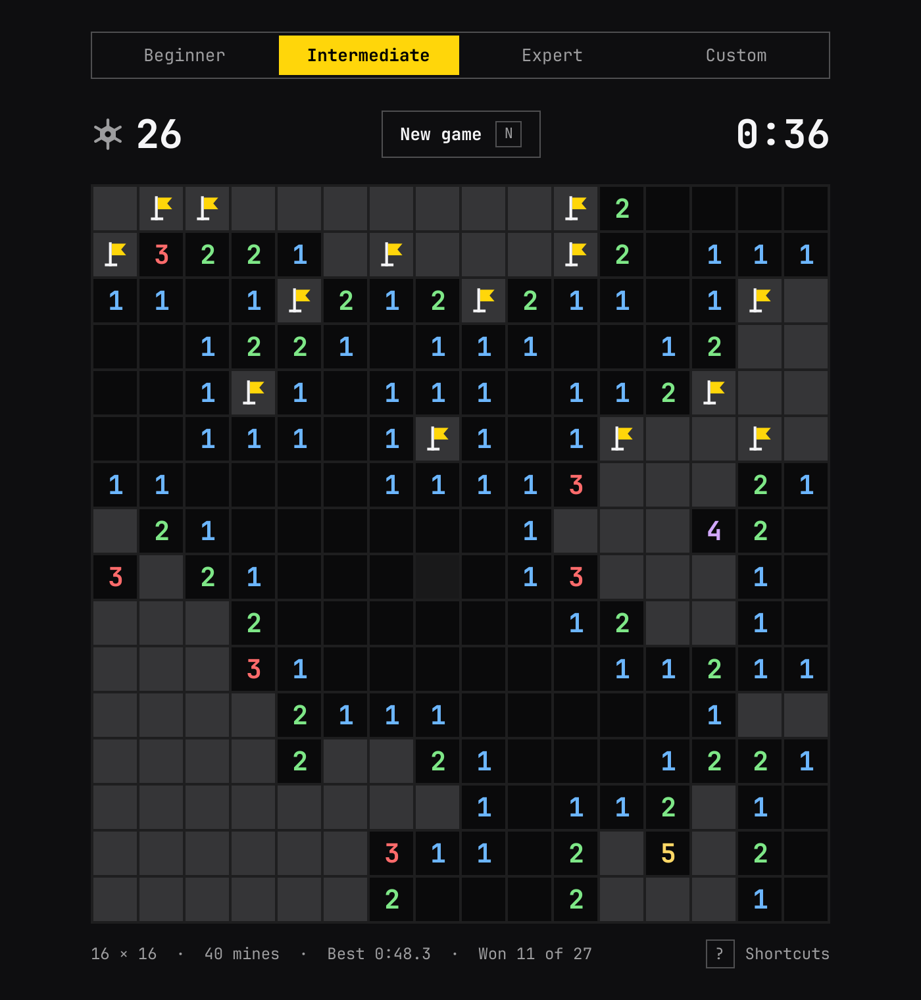

# Mines



A mine-clearing puzzle for [Omarchy](https://omarchy.org). Open every cell
that has no mine under it; a number says how many mines touch that cell.

- **Four levels**: Beginner (9 × 9, 10 mines), Intermediate (16 × 16, 40),
  Expert (30 × 16, 99), and Custom (up to 50 × 30).
- **The first move is always safe**, and always opens an area rather than a
  lone number.
- **Mouse or keyboard, or both at once**: keys act on the cell under the
  pointer, so hovering and pressing `F` flags without a right click.
- **Best times and win counts** for every level, and for every custom board
  size, kept in `~/.local/share/mines/`.
- **Follows the Omarchy theme live**: accent, background, the palette the
  numbers are drawn in, light or dark, and the window rounding.
- **Follows the Omarchy language live**: English, Danish, Dutch, French,
  German, Italian, Portuguese, Spanish, and Swedish so far.
- The clock stops and the board is covered whenever the window is out of
  focus, so a game left on another workspace doesn't run on.

## Install

```sh
bin/install
```

That builds the app and installs it as an Arch package (`mines`), which puts
**Mines** in the app launcher (`Super + Space`). It needs what Omarchy
already has: `qt6-base`, `qt6-declarative`, `qt6-svg`, `qt6-wayland`, and a
C++ compiler.

## Play

| With the mouse | |
| --- | --- |
| Left click | Open a cell, or chord on a number |
| Right click | Flag a cell, or take the flag off |
| Middle click, or left and right together | Chord |

A *chord* is the quick way through: on an open number that already has that
many flags around it, it opens every other cell around the number in one go.

| Key | |
| --- | --- |
| `←` `↓` `↑` `→` or `H` `J` `K` `L` | Move around the board |
| `Home` `End` `PgUp` `PgDn` | Jump to the edge of the row or column |
| `Space` or `Enter` | Open a cell, or chord on a number |
| `F` | Flag a cell, or take the flag off |
| `C` | Chord |
| `N` | New game |
| `1` `2` `3` `4` | Beginner, Intermediate, Expert, Custom |
| `P` | Pause |
| `B` | Best times |
| `?` | Show or hide the shortcuts |
| `Q` | Quit (asks first in the middle of a game) |

## Develop

```sh
bin/build    # qmake6 + make, into build/mines
bin/test     # the Qt Test suite, offscreen
```

C++ holds the game (`src/board.*` is the rules, `src/game.*` the clock, the
levels, and the model the window draws, `src/scores.*` the best times); QML
holds the window. Translations are `src/i18n/<code>.json`, English text to
translation, compiled into the binary.

## License

MIT. The theme watcher, the translator, and the build scripts follow
[Omacut](https://github.com/omacom-io/omacut) and
[Monologue](https://github.com/omacom/monologue) by David Heinemeier Hansson.
